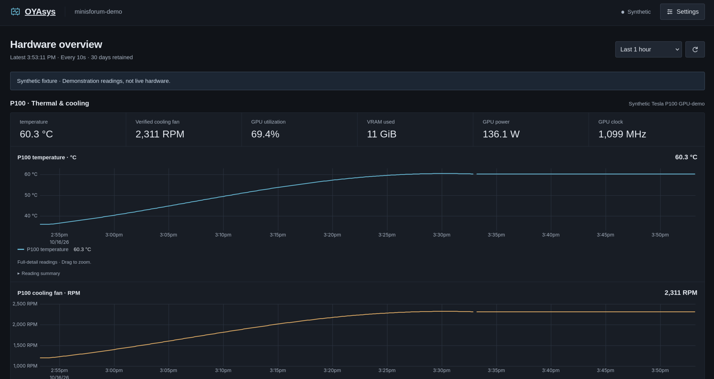

# OYAsys Dashboard

Standalone Linux hardware monitoring, with a dedicated NVIDIA P100 temperature and verified motherboard cooling-fan view. A simple dashboard, served by one native process.

I made this to monitor my P100 GPU and gather some historical temps during normal usage. It's cooled by a 120mm fan which is not adequate cooling under max benchmark tests, but was passable in basic usage tests. After setting a conservative cooling curve based on initial testing, I set this up to assist with tuning the fan and GPU power limits based on actual usage. 



- CPU, memory, swap, temperatures, fans, filesystem capacity, disk/network rates, uptime, and available hardware specifications.
- Optional NVIDIA telemetry through the existing NVML driver library.
- Sampling defaults to **10 seconds**; full-detail retention to **30 days**. Both are editable in Settings, alongside the verified P100 fan mapping.
- Embedded SQLite and static browser charts. No Grafana, Prometheus, database daemon, Node runtime, container, or extra proxy on the server.
- Read-only hardware access. Existing Linux fan control remains independent.
- Settings can check for published updates and install a compatible release. The updater runs only on request, with a backup and startup verification; no extra idle daemon.

## Install

Use [manual installation and Coolify routing](docs/installation.md). Run `oyasys discover` on the monitored server to inspect actual sources before assigning a cooling fan.

The installer preserves configuration and history. Network access is limited through your existing LAN/Tailscale, firewall, and Coolify proxy; the application has no login. Use the existing proxy for your chosen hostname and TLS.

## Develop

```sh
cargo build --locked
cargo run --locked -- discover
cargo run --locked -- serve --data-dir ./data
# Open http://127.0.0.1:9850
```

Rust and a C compiler build the bundled SQLite library. Node is needed only for frontend checks; web assets are already vendored. The executable embeds fingerprinted, build-compressed assets.

```sh
npm ci
npm run check
cargo fmt --check
cargo clippy --locked --all-targets -- -D warnings
cargo test --locked
cargo build --locked
npm run test:browser
python3 tests/storage_faults.py
python3 tests/telemetry_availability.py
python3 tests/updater.py
```

Browser tests use `/usr/bin/chromium` by default; set `CHROMIUM_PATH` to an installed Chromium. `OYASYS_BINARY` selects a different built executable.

```sh
cargo build --release --locked
sh tools/package.sh
```

This produces `dist/oyasys-linux-x86_64.tar.gz`, a SHA-256 file, and `dist/oyasys-update.json`. A local archive inherits the build machine's glibc requirement; the CI workflow builds on Ubuntu 22.04 for a broader GNU/Linux baseline. Target-server compatibility remains a manual check. Matching stable version tags publish tested release assets; see [updates and release publishing](docs/updates.md).

## Design and verification

See [architecture and storage format](docs/architecture.md), [HTTP contract](docs/api.md), [resource measurements](docs/performance.md), and [visual conventions](DESIGN.md). Synthetic fixtures always identify themselves in the UI.

See the [domain glossary](CONTEXT.md) and [product principles](PRODUCT.md) for terminology and scope.

Local tests do not establish Minisforum sensor support or P100 driver cost. Actual fan identity, service-user permissions, proxy routing, and target-host resource qualification remain owner-run.
